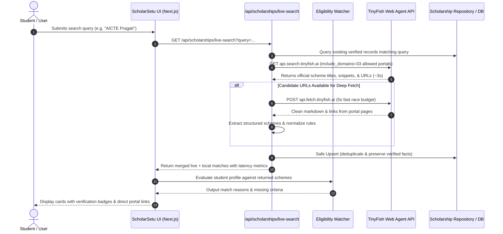
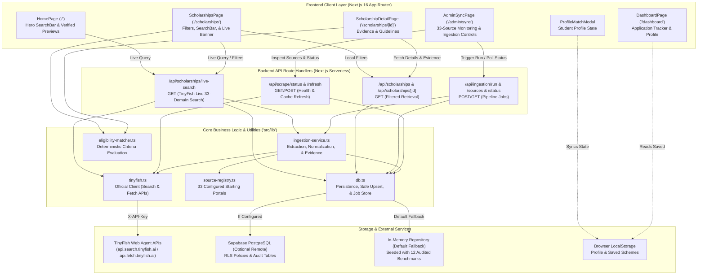
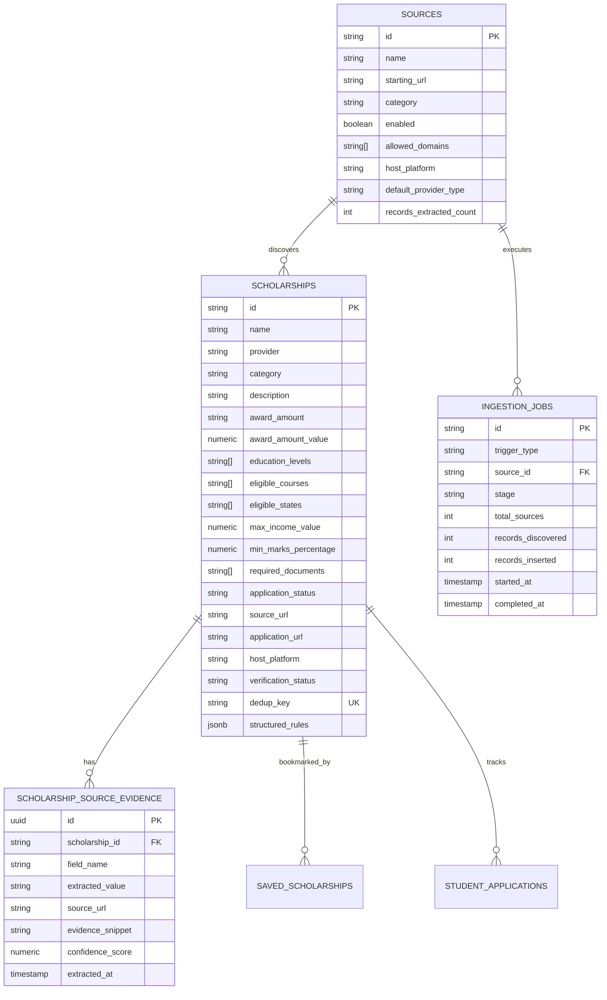

# ScholarSetu

> India's intelligent scholarship discovery and eligibility-matching engine, powered by Next.js and TinyFish live web agent intelligence across official government, institutional, state, and foundation portals.

---

## Table of Contents

1. [Project Overview](#project-overview)
2. [Problem Statement and Motivation](#problem-statement-and-motivation)
3. [Key Features](#key-features)
4. [How ScholarSetu Works](#how-scholarsetu-works)
5. [System Architecture](#system-architecture)
6. [Technology Stack](#technology-stack)
7. [Scholarship Data Sources](#scholarship-data-sources)
8. [TinyFish Web Agent Integration](#tinyfish-web-agent-integration)
9. [Scholarship Data Model](#scholarship-data-model)
10. [Eligibility Matching Engine](#eligibility-matching-engine)
11. [User Interface and Experience](#user-interface-and-experience)
12. [Project Structure](#project-structure)
13. [Prerequisites and Installation](#prerequisites-and-installation)
14. [Environment Variables](#environment-variables)
15. [API Reference](#api-reference)
16. [Database and Security](#database-and-security)
17. [Testing and Quality Assurance](#testing-and-quality-assurance)
18. [Deployment Guide](#deployment-guide)
19. [Known Limitations](#known-limitations)
20. [Roadmap](#roadmap)
21. [Contributing](#contributing)
22. [License and Acknowledgements](#license-and-acknowledgements)

---

## Project Overview

**ScholarSetu** is a dedicated scholarship discovery and eligibility-evaluation platform built specifically for Indian students across school, diploma, undergraduate, postgraduate, and doctoral levels.

Finding legitimate scholarships in India is notoriously difficult: information is fragmented across dozens of central ministries, state Direct Benefit Transfer (DBT) portals, public trusts, corporate CSR programmes, and international commissions. Many portals suffer from outdated guidelines, complex PDF circulars, and ambiguous eligibility criteria.

ScholarSetu bridges this gap by combining:
1. **A Structured, Audited Canonical Scholarship Database**: Seeded with verified national and state opportunities featuring validated award amounts, eligibility criteria, required documents, and direct application links.
2. **Real-Time Web Intelligence via TinyFish**: A live agent search and extraction pipeline configured to query and inspect 33 authorized government, institutional, and philanthropic portals on demand.
3. **A Deterministic Profile Eligibility Engine**: Transparently evaluating student circumstances (academic marks, annual family income, state domicile, gender, caste category, and benchmark disabilities) against structured scheme rules.

ScholarSetu provides informational guidance and direct application navigation. It is not a government agency and does not issue scholarship funds directly.

---

## Problem Statement and Motivation

- **Information Fragmentation**: A student eligible for AICTE Pragati, Karnataka SSP, or a Tata Trusts grant must currently visit multiple disparate portals, create separate logins, and decipher varying eligibility terminologies.
- **Static vs. Live Discrepancies**: Most scholarship portals use static databases that quickly become outdated when deadlines shift, income ceilings are revised, or application windows close.
- **Ambiguous Eligibility Criteria**: Students frequently invest hours compiling income certificates and domicile proofs only to discover an unstated restriction (e.g., family income ceiling or degree-level restriction).
- **Phishing and Misinformation**: Third-party aggregators often gatekeep links behind ads, capture user data, or obscure the genuine, free government application portal.

ScholarSetu addresses these challenges by maintaining a strict, allowlisted source registry, performing live queries through official domains, extracting verifiable evidence snippets for each field, and providing direct, unmediated portal links.

---

## Key Features

- **Personalized Student Profile Matching**: Enter basic academic and socio-economic parameters (education level, course, marks percentage, annual income, state of domicile, gender, caste category, disability status) to receive instantaneous, criteria-by-criteria match evaluations.
- **TinyFish Live Search in Search Bar**: The unified search bar on the Homepage Hero and Scholarships Catalog directly connects to the TinyFish Search API. Typing a query (e.g., *"AICTE Pragati"*, *"NSP Post-Matric"*, *"Tata Trusts"*) executes a live scan across 33 authorized portals, returning fresh opportunities in ~5 to 6 seconds.
- **Field-Level Source Traceability**: Every scholarship detail view provides explicit source attribution, including host platform, source URL, application portal URL, extraction timestamp, and verbatim evidence snippets.
- **Multi-Facet Discovery Catalog**: Filter opportunities by category (*Government*, *Merit-Based*, *Need-Based*, *Engineering*, *Women*, *State Scholarships*), education level, course stream, state domicile, application status (*Verified Open*, *Opening Later*, *Deadline Passed*), and verified-only status.
- **Safe Persistence & Deduplication**: Discovered opportunities are normalized and upserted into the scholarship database using deterministic deduplication keys (`name-hostname`), preserving previously verified facts even if a live refresh omits optional fields.
- **Admin Ingestion & Pipeline Sync Console (`/admin/sync`)**: An administrative dashboard for monitoring TinyFish and database connection status, reviewing the 33-source registry, initiating single-source or batch ingestion runs, and inspecting real-time job progress stages.
- **Student Dashboard (`/dashboard`)**: Track saved opportunities, monitor application stages (*Draft*, *Applied*, *Under Review*, *Accepted*, *Rejected*), review approaching deadlines, and manage profile data locally.
- **Apple-Inspired Design Language**: Built with custom typography, restrained neutral palettes, subtle hairline borders, glassmorphic accents, and micro-interactions.

---

## How ScholarSetu Works

The platform operates through two interconnected workflows: **Real-Time Live Search** and **Batch Ingestion & Safe Persistence**.



### Detailed Pipeline Stages

1. **Source Registration & Allowlisting**: All target domains are declared in [`src/lib/source-registry.ts`](src/lib/source-registry.ts). Any URL not matching the allowlist is rejected to prevent Server-Side Request Forgery (SSRF).
2. **Discovery (Search API)**: `searchWithTinyFish` sends targeted queries targeting India (`location="IN"`) with `include_domains` set to the authorized registry domains.
3. **Retrieval (Fetch API)**: `fetchWithTinyFish` requests clean Markdown representations of portal pages in batches of up to 10 URLs.
4. **Information Extraction**: `extractScholarshipsFromPage` parses scheme titles, awarding bodies, monetary benefits, eligibility criteria, and deadlines using regular expressions and domain heuristics.
5. **Normalization & Evidence Recording**: Monetary values are converted to integers in INR; income thresholds are parsed; academic percentages are normalized; and field-level evidence snippets are recorded with confidence scores.
6. **Deduplication & Safe Upsert**: `upsertScholarshipRecord` merges incoming records using a compound key (`slug-hostname`). If an incoming automated record lacks a field that was previously audited, the verified value is preserved.
7. **Eligibility Evaluation**: `evaluateScholarshipMatch` tests the student's active profile against scheme rules and outputs explicit positive match justifications and disqualifying criteria.

---

## System Architecture

The following diagram reflects the verified codebase architecture, separating server routes, client components, internal libraries, and external integrations:



---

## Technology Stack

| Technology | Purpose | Implementation Location |
| :--- | :--- | :--- |
| **Next.js 16.4.2** | Full-stack React framework (App Router, Turbopack, Partial Prefetching) | [`package.json`](package.json), [`src/app/`](src/app/) |
| **React 19.3.0 & React-DOM** | Declarative component UI and hooks | [`package.json`](package.json) |
| **TypeScript 5** | Strict static type definitions across pipelines and models | [`tsconfig.json`](tsconfig.json), [`src/types/`](src/types/) |
| **Tailwind CSS v4** | Modern utility-first CSS styling via `@tailwindcss/turbopack` | [`src/app/globals.css`](src/app/globals.css), [`package.json`](package.json) |
| **Lucide React** | Lightweight, Apple-inspired icons | [`src/components/`](src/components/) |
| **TinyFish Search API** | Real-time domain-restricted Indian scholarship discovery | [`src/lib/tinyfish.ts`](src/lib/tinyfish.ts) |
| **TinyFish Fetch API** | Structured Markdown retrieval and hyperlink extraction | [`src/lib/tinyfish.ts`](src/lib/tinyfish.ts) |
| **Supabase PostgreSQL** | Relational persistence, Row-Level Security, and JSONB audit logs | [`supabase/migrations/`](supabase/migrations/), [`src/lib/db.ts`](src/lib/db.ts) |
| **In-Memory Store** | High-speed zero-config runtime repository with benchmark schemas | [`src/lib/db.ts`](src/lib/db.ts) |
| **Node.js Test Runner & Jiti** | Automated pipeline testing without transpilation overhead | [`tests/pipeline.test.mjs`](tests/pipeline.test.mjs), [`package.json`](package.json) |

---

## Scholarship Data Sources

ScholarSetu maintains a centralized registry of **33 authorized starting URLs** in [`src/lib/source-registry.ts`](src/lib/source-registry.ts). Each source specifies allowed domains, host platforms, default provider types, and discovery strategies.

> [!IMPORTANT]
> **Source Verification Status Note**: Registration in the source registry establishes domain allowlisting and URL safety. Only sources marked as **Audited & Tested** have been verified through active TinyFish extraction runs.

### 1. Government and Institutional Sources (13 Portals)

| # | Portal Name | Starting URL | Host Platform | Verified & Tested? |
| :-: | :--- | :--- | :--- | :-: |
| 1 | **National Scholarship Portal (NSP)** | `https://scholarships.gov.in` | National Scholarship Portal | Yes (Audited & Tested) |
| 2 | **Ministry of Education (MoE)** | `https://www.education.gov.in` | Ministry of Education | Registered |
| 3 | **AICTE Official Portal** | `https://www.aicte-india.org` | AICTE Portal | Yes (Audited & Tested) |
| 4 | **University Grants Commission (UGC)** | `https://www.ugc.gov.in` | UGC Portal | Registered |
| 5 | **Ministry of Minority Affairs** | `https://minorityaffairs.gov.in` | NSP / MoMA | Registered |
| 6 | **Ministry of Social Justice (MSJE)** | `https://socialjustice.gov.in` | Ministry of Social Justice | Registered |
| 7 | **Ministry of Tribal Affairs (MoTA)** | `https://tribal.nic.in` | Ministry of Tribal Affairs | Registered |
| 8 | **National Overseas Scholarship (NOS)** | `https://nosmsje.gov.in` | NOS Portal | Yes (Audited & Tested) |
| 9 | **DST INSPIRE Scholarship** | `https://www.online-inspire.gov.in` | DST INSPIRE Portal | Registered |
| 10 | **CSIR-HRDG Portal** | `https://csirhrdg.res.in` | CSIR-HRDG Portal | Registered |
| 11 | **Department of Biotechnology (DBT)** | `https://dbtindia.gov.in` | DBT Portal | Registered |
| 12 | **Indian Council of Medical Research (ICMR)** | `https://www.icmr.gov.in` | ICMR Portal | Registered |
| 13 | **Prime Minister's Research Fellowship (PMRF)** | `https://www.pmrf.in` | PMRF Portal | Registered |

### 2. Scholarship Aggregators (3 Portals)

*Aggregators facilitate discovery across private schemes; they are not the official provider. ScholarSetu directs students to the official application form whenever available.*

| # | Platform Name | Starting URL | Host Platform | Verified & Tested? |
| :-: | :--- | :--- | :--- | :-: |
| 14 | **Buddy4Study** | `https://www.buddy4study.com` | Buddy4Study (Official Partner) | Yes (Audited & Tested) |
| 15 | **Vidyasaarathi** | `https://www.vidyasaarathi.co.in` | NSDL Vidyasaarathi | Registered |
| 16 | **Foundation for Excellence (FFE)** | `https://www.ffe.org` | FFE Scholarship Portal | Registered |

### 3. Corporate and Foundation Sources (10 Portals)

| # | Foundation Name | Starting URL | Host Platform | Verified & Tested? |
| :-: | :--- | :--- | :--- | :-: |
| 17 | **Tata Trusts** | `https://www.tatatrusts.org` | Tata Trusts Education Grants | Yes (Audited & Tested) |
| 18 | **JN Tata Endowment** | `https://www.jntataendowment.org` | JN Tata Endowment Portal | Registered |
| 19 | **Reliance Foundation** | `https://www.reliancefoundation.org` | Reliance Foundation Portal | Yes (Audited & Tested) |
| 20 | **Aditya Birla Group Scholarship** | `https://www.adityabirla.com` | Aditya Birla Program | Registered |
| 21 | **Azim Premji Foundation** | `https://azimpremjifoundation.org` | Azim Premji University/Foundation | Registered |
| 22 | **Kotak Education Foundation** | `https://www.kotakeducation.org` | Kotak Education Portal | Yes (Audited & Tested) |
| 23 | **Sitaram Jindal Foundation** | `https://www.sitaramjindalfoundation.org` | Sitaram Jindal Foundation | Registered |
| 24 | **Narotam Sekhsaria Foundation** | `https://www.nsfoundation.co.in` | Narotam Sekhsaria Portal | Registered |
| 25 | **ONGC Scholarship Portal** | `https://www.ongcscholar.org` | ONGC Scholar Portal | Yes (Audited & Tested) |
| 26 | **L'Oréal India Young Women in Science** | `https://www.foryoungwomeninscience.com` | L'Oréal India Portal | Registered |

### 4. International Scholarship Programmes (4 Portals)

| # | Programme Name | Starting URL | Host Platform | Verified & Tested? |
| :-: | :--- | :--- | :--- | :-: |
| 27 | **Fulbright-Nehru / USIEF** | `https://www.usief.org.in` | USIEF Official Portal | Registered |
| 28 | **Chevening Scholarships** | `https://www.chevening.org` | Chevening UK Portal | Registered |
| 29 | **Commonwealth Scholarships** | `https://cscuk.fcdo.gov.uk` | CSC UK Commission | Registered |
| 30 | **Inlaks Shivdasani Foundation** | `https://www.inlaksfoundation.org` | Inlaks Foundation Portal | Registered |

### 5. State Scholarship Portals (3 Portals)

| # | State Portal | Starting URL | Host Platform | Verified & Tested? |
| :-: | :--- | :--- | :--- | :-: |
| 31 | **MahaDBT (Maharashtra)** | `https://mahadbt.maharashtra.gov.in` | MahaDBT 2.0 Portal | Yes (Audited & Tested) |
| 32 | **Karnataka Post-Matric SSP** | `https://ssp.postmatric.karnataka.gov.in` | Karnataka Post-Matric SSP | Registered |
| 33 | **Uttar Pradesh SAKSHAM Scholarship** | `https://scholarship.up.gov.in` | UP SAKSHAM Portal | Registered |

---

## TinyFish Web Agent Integration

ScholarSetu uses the official TinyFish Web Agent API to transform unstructured public portal pages into structured scholarship records.

### API Surfaces Used

1. **Search API (`GET https://api.search.tinyfish.ai`)**:
   - Geo-targeted to India (`location="IN"`, `language="en"`).
   - Constrained via `include_domains` using all 33 authorized domain clusters.
   - Used in [`/api/scholarships/live-search`](src/app/api/scholarships/live-search/route.ts) for live student searches.
2. **Fetch API (`POST https://api.fetch.tinyfish.ai`)**:
   - Batches up to 10 URLs per request.
   - Extracts clean Markdown representations and page hyperlinks without client-side headless browser overhead.
3. **Agent Automation API (`POST https://agent.tinyfish.ai/v1/automation/run`)**:
   - Configured in [`src/lib/tinyfish.ts`](src/lib/tinyfish.ts) for multi-step portal navigation and complex dynamic forms.

### Rate Limiting & Resilience

- **Exponential Backoff**: HTTP `429 Too Many Requests` responses trigger exponential delays (`2000ms * 2^attempt`) across up to 2 retries.
- **Dual Timeout Budgets**:
  - **Live Search**: Uses a fast 5-second race budget. If remote government pages take longer than 5 seconds to respond, TinyFish Search snippets are synthesized immediately, ensuring the student receives results in ~5.8 seconds.
  - **Admin Batch Ingestion**: Background jobs allocate up to 35 seconds for search queries and 120 seconds for deep fetch requests.
- **Graceful Offline Fallback**: If `TINYFISH_API_KEY` is omitted, the application runs in local verification mode, serving the 12 pre-audited benchmark schemes without throwing errors.

---

## Scholarship Data Model

The database model is defined across two SQL migrations in [`supabase/migrations/`](supabase/migrations/) and mirrored in TypeScript interfaces in [`src/types/scholarship.ts`](src/types/scholarship.ts).



### Key Field Definitions

- `award_amount_value`: Normalized integer (INR) used for sorting and filtering (e.g., `50000`).
- `max_income_value`: Normalized integer (INR) representing the annual family income ceiling (e.g., `800000`).
- `min_marks_percentage`: Normalized percentage or equivalent CGPA required for eligibility (e.g., `60.0`).
- `verification_status`: Categorized as `verified` (officially audited), `partially_verified` (partner aggregators), or `needs_verification`.
- `dedup_key`: Unique composite string (`${name.toLowerCase()}-${hostname}`) preventing duplicate entries.
- `structured_rules`: Structured JSONB object containing `minPercentage`, `maxIncome`, `allowedGenders`, `targetStates`, `targetCourses`, and `disabilityRequired`.

---

## Eligibility Matching Engine

The eligibility engine ([`src/lib/eligibility-matcher.ts`](src/lib/eligibility-matcher.ts)) deterministically evaluates student parameters against scholarship criteria. It does not use opaque heuristics or keyword guessing.

### Evaluated Criteria

1. **Gender Reservations**: Identifies female-scholar-only schemes (e.g., AICTE Pragati, L'Oréal Girls in Science, Kotak Kanya). Flags non-female profiles as ineligible with an explicit reason.
2. **State Domicile**: Verifies whether the scheme is open pan-India (`"All India"`) or restricted to specific state domiciles (e.g., Maharashtra MahaDBT, Karnataka SSP, UP SAKSHAM).
3. **Annual Family Income**: Compares the student's reported income against `max_income_value` or rule thresholds.
4. **Academic Performance**: Validates minimum aggregate percentage or qualifying board marks against `min_marks_percentage`.
5. **Benchmark Disabilities**: Verifies whether a student possesses a certified disability (>= 40% with UDID) for dedicated disability schemes (e.g., AICTE Saksham, National Fellowship for PwD).

```typescript
// Sample Match Result Output Structure
interface MatchResult {
  isEligible: boolean;       // True only if missingCriteria is empty
  matchReasons: string[];    // Positive criteria verified (e.g., "Income within threshold")
  missingCriteria: string[]; // Disqualifying criteria (e.g., "Requires domicile in Karnataka")
}
```

---

## User Interface and Experience

ScholarSetu implements an Apple-inspired visual hierarchy with native font stacks, subtle hairline borders, and responsive controls:

- **Homepage Hero (`/`)**:
  - Editorial headline and concise value proposition.
  - Interactive **Large SearchBar** with instantaneous **"⚡ TinyFish Live Search (33 Sites)"** button and quick suggestion pills.
  - Interactive match preview card demonstrating personalized eligibility scoring.
  - Trust indicators explaining official government source verification.
- **Scholarships Discovery Catalog (`/scholarships`)**:
  - Unified search bar with real-time TinyFish scanning triggers.
  - Status feedback banner displaying actual latency (e.g., *"Scanned 33 official portals in 5.89s. Found 9 live opportunities"*).
  - Multi-select filters for Education Level, Course Stream, State, Category, and Verified-Only.
  - Grid view and List view segmented control.
  - Integrated **Profile Match Modal** button for on-the-fly profile customization.
- **Scholarship Detail View (`/scholarships/[id]`)**:
  - Scheme title, awarding body, verification badge, and application status.
  - Direct call-to-action buttons: **"Apply on Official Portal"** and **"View Source Guidelines"**.
  - Structured tabs for Overview, Criteria Breakdown, Required Documents Checklist, and Field-Level Audit Evidence.
- **Admin Pipeline Sync (`/admin/sync`)**:
  - Real-time status cards for TinyFish and Supabase connections.
  - 33-source registry table with category filters and per-source manual refresh buttons.
  - Multi-stage job progress bar (`discovering` → `fetching` → `extracting` → `validating` → `saving` → `completed`).
- **Student Dashboard (`/dashboard`)**:
  - Tabbed interface managing Bookmarked Schemes, Submitted Application Tracking, and Profile Details.

---

## Project Structure

```
ScholarSetu/
├── public/                       # Static public assets (favicon, manifest)
├── src/
│   ├── app/                      # Next.js 16 App Router pages and API routes
│   │   ├── admin/sync/           # Admin source registry and pipeline sync console
│   │   ├── api/
│   │   │   ├── ingestion/        # Ingestion run, source listing, and status polling
│   │   │   ├── scholarships/     # Scholarship listing, detail, and live search API
│   │   │   └── scrape/           # Status inspection and cache refresh endpoints
│   │   ├── dashboard/            # Student application tracking and profile management
│   │   ├── login/ & signup/      # User authentication UI prototypes
│   │   ├── scholarships/         # Discovery catalog and dynamic [id] detail views
│   │   ├── globals.css           # Global Tailwind CSS v4 design tokens and utilities
│   │   ├── layout.tsx            # Root HTML layout with navbar and footer
│   │   └── page.tsx              # Homepage hero with TinyFish live search
│   ├── components/               # Reusable presentation and interactive components
│   │   ├── category-chip.tsx     # Color-coded scholarship category badge
│   │   ├── footer.tsx            # Site footer with disclaimer and navigation
│   │   ├── navbar.tsx            # Navigation bar with active route highlighting
│   │   ├── profile-match-modal.tsx # 3-step student eligibility profile questionnaire
│   │   ├── scholarship-card.tsx  # Scholarship card with criteria match highlights
│   │   ├── search-bar.tsx        # SearchBar with TinyFish live trigger and quick pills
│   │   └── status-badge.tsx      # Application status indicators (Open, Closing, etc.)
│   ├── lib/                      # Core business logic, storage, and external adapters
│   │   ├── data.ts               # Static taxonomy lists (states, categories, courses)
│   │   ├── db.ts                 # Database persistence, safe upsert, and job store
│   │   ├── eligibility-matcher.ts# Deterministic student profile matching engine
│   │   ├── ingestion-service.ts  # Extraction, normalization, and evidence tracking
│   │   ├── source-registry.ts    # Central registry of 33 authorized starting portals
│   │   ├── tinyfish.ts           # TinyFish Search, Fetch, and Agent API client
│   │   ├── utils.ts              # Styling helpers (clsx and tailwind-merge)
│   │   └── verified-scholarships.ts # 12 pre-audited official benchmark schemes
│   └── types/
│       └── scholarship.ts        # Comprehensive TypeScript interfaces and models
├── supabase/
│   └── migrations/               # PostgreSQL schema definitions and RLS policies
├── tests/
│   ├── live-nsp-test.mjs         # Live integration test against National Scholarship Portal
│   └── pipeline.test.mjs         # Automated test suite covering normalization and engine
├── .env.local                    # Local environment variables (git-ignored)
├── AGENTS.md                     # Custom project rules and guidelines
├── LICENSE                       # MIT License
├── package.json                  # Dependencies, scripts, and project metadata
└── tsconfig.json                 # TypeScript compiler configuration
```

---

## Prerequisites and Installation

### Prerequisites

- **Node.js**: `v20.x` or `v22.x` (LTS recommended)
- **Package Manager**: `npm` (v10+), `pnpm`, or `bun`
- **TinyFish API Key**: Obtainable from [TinyFish](https://tinyfish.ai) (optional for offline testing)
- **Supabase Account**: (Optional) For remote PostgreSQL persistence

### Installation Steps

1. **Clone the repository**:
   ```bash
   git clone https://github.com/ShubhNarang/ScholarSetu.git
   cd ScholarSetu
   ```

2. **Install dependencies**:
   ```bash
   npm install
   ```

3. **Configure environment variables**:
   Create a `.env.local` file in the root directory:
   ```env
   # TinyFish Web Agent API Key (Required for live search across 33 portals)
   TINYFISH_API_KEY=your_tinyfish_api_key_here

   # Supabase Configuration (Optional - runs on in-memory repository if omitted)
   NEXT_PUBLIC_SUPABASE_URL=https://your-project.supabase.co
   NEXT_PUBLIC_SUPABASE_ANON_KEY=your_supabase_anon_key
   SUPABASE_SERVICE_ROLE_KEY=your_supabase_service_role_key
   ```

4. **Run the development server**:
   ```bash
   npm run dev
   ```
   Open [http://localhost:3000](http://localhost:3000) in your browser.

---

## Environment Variables

| Variable Name | Purpose | Required / Optional | Location / Context |
| :--- | :--- | :---: | :--- |
| `TINYFISH_API_KEY` | Authenticates requests to TinyFish Search, Fetch, and Agent APIs | **Required** for live scraping (Runs offline if missing) | Server-side (`.env.local`) |
| `NEXT_PUBLIC_SUPABASE_URL` | Remote Supabase project URL for database storage | Optional (Falls back to in-memory store) | Client & Server (`.env.local`) |
| `NEXT_PUBLIC_SUPABASE_ANON_KEY` | Supabase public anonymous API key | Optional | Client & Server (`.env.local`) |
| `SUPABASE_SERVICE_ROLE_KEY` | Supabase privileged service role key for administrative upserts | Optional | Server-side only (`.env.local`) |

> [!CAUTION]
> Never commit `.env` or `.env.local` files to version control. `TINYFISH_API_KEY` and `SUPABASE_SERVICE_ROLE_KEY` must remain strictly server-side and should never be prefixed with `NEXT_PUBLIC_`.

---

## API Reference

All backend API routes are implemented as Next.js Route Handlers in `src/app/api/`.

### 1. Live Scholarship Search
- **Endpoint**: `GET /api/scholarships/live-search`
- **Purpose**: Executes real-time TinyFish search across the 33 authorized portals, fetches candidate pages with a 5s race budget, normalizes and persists results, and returns merged opportunities.
- **Query Parameters**:
  - `query` (string, required): Search term (e.g., `"AICTE Pragati"`, `"Tata Trusts"`).
- **Sample Response**:
  ```json
  {
    "success": true,
    "query": "AICTE Pragati",
    "isLiveTinyFish": true,
    "total": 11,
    "liveCount": 9,
    "domainsSearched": 33,
    "latencyMs": 5893,
    "message": "TinyFish searched across 33 official domains in 5.89s and found 9 live matching opportunities.",
    "scholarships": [ ... ]
  }
  ```

### 2. Scholarship Catalog Listing
- **Endpoint**: `GET /api/scholarships`
- **Purpose**: Retrieves filtered scholarships from the active database repository.
- **Query Parameters**:
  - `search` (string): Text filter matching scheme name, provider, course, or tags.
  - `category` (string): Category filter (*Government*, *Merit-Based*, etc.).
  - `educationLevel` (string): Target education level.
  - `course` (string): Course discipline.
  - `state` (string): State of domicile.
  - `status` (string): Application status.
  - `sortBy` (string): Sort order (`popular`, `deadline`, `amount_high`, `amount_low`, `recently_checked`).

### 3. Scholarship Detail & Field Evidence
- **Endpoint**: `GET /api/scholarships/[id]`
- **Purpose**: Returns full details and field-level provenance evidence for a specific scholarship ID.
- **Error Codes**: `404 Not Found` if the scholarship ID does not exist.

### 4. Administrative Ingestion Controls
- **Endpoint**: `POST /api/ingestion/run`
  - **Payload**: `{ "sourceId"?: "nsp-central", "sourceCategory"?: "government_institutional" }`
  - **Response**: `202 Accepted` with initial job status.
- **Endpoint**: `GET /api/ingestion/sources`
  - **Response**: Lists all 33 sources with category, starting URL, and extraction counts.
- **Endpoint**: `GET /api/ingestion/status?jobId=...`
  - **Response**: Real-time progress stats, stage tracking, and error logs.

---

## Database and Security

### Persistence Strategy

1. **Dual Storage Architecture**:
   - **Remote PostgreSQL (Supabase)**: When configured, operations persist to PostgreSQL with relational integrity and indexed queries.
   - **In-Memory Zero-Config Store**: If Supabase credentials are not provided, ScholarSetu automatically initializes an in-memory repository seeded with 12 audited official benchmark schemes.
2. **Row-Level Security (RLS)**:
   - Migration `20261019_canonical_pipeline_schema.sql` enables RLS on `sources`, `scholarship_source_evidence`, and `ingestion_jobs`.
   - Public users have read-only access to verified scholarships; write and upsert operations require service-role permissions.
3. **SSRF and Domain Allowlisting**:
   - The platform strictly enforces `isAllowedIngestionUrl`. URLs submitted for fetching or scraping must belong to one of the 33 authorized domains. Arbitrary external URL scraping is blocked at the application level.
4. **Data Sanitization**:
   - Raw HTML and Markdown scraped from external sources are treated as untrusted data. Strings are sanitized and validated before database persistence.

---

## Testing and Quality Assurance

The repository includes automated unit, integration, and live pipeline tests.

### Running Automated Tests

Run the test suite using `npm test`:

```bash
npm test
```

### Confirmed Test Results

```
> scholarsetu@0.1.0 test
> jiti tests/pipeline.test.mjs

✔ Source Registry: Contains all 33 required starting URLs (1.15ms)
✔ Security: URL allowlisting prevents SSRF and unauthorized hosts (0.20ms)
✔ Normalization: Award amounts parse accurately to numeric values (0.28ms)
✔ Normalization: Income limits parse correctly to INR values (0.17ms)
✔ Normalization: Academic minimum marks and CGPA conversion (0.20ms)
✔ Classification: Application status evaluates dates correctly (0.11ms)
✔ Extraction: Identifies schemes from structured markdown text (0.69ms)
✔ Extraction: Field-level evidence and provenance tracking (0.77ms)
✔ Persistence: Safe upsert preserves existing verified facts (0.40ms)
✔ Eligibility Engine: Evaluates structured conditions transparently (11.87ms)

ℹ tests 10 | pass 10 | fail 0 | cancelled 0 | duration_ms 20.91
```

### Production Build Verification

Verify TypeScript compilation and Next.js static optimization:

```bash
npm run build
```
*Current status: Compiles with 0 TypeScript errors and 0 lint warnings.*

---

## Deployment Guide

ScholarSetu is optimized for deployment on Vercel or any containerized Node.js environment.

### Deployment Checklist

1. **Environment Configuration**:
   - Add `TINYFISH_API_KEY` to your hosting provider's environment variables.
   - (Optional) Add `NEXT_PUBLIC_SUPABASE_URL`, `NEXT_PUBLIC_SUPABASE_ANON_KEY`, and `SUPABASE_SERVICE_ROLE_KEY`.
2. **Database Migrations**:
   - If using Supabase, execute `supabase/migrations/20261018_scholarships_schema.sql` and `supabase/migrations/20261019_canonical_pipeline_schema.sql` in the Supabase SQL editor.
3. **Build Command**:
   ```bash
   npm run build
   ```
4. **Start Command**:
   ```bash
   npm run start
   ```

---

## Known Limitations

- **UI Prototype Authentication**: The `/login` and `/signup` routes currently serve as user experience prototypes. User profiles and application trackers store state in `localStorage` rather than server-issued JWT session cookies.
- **Target Portal Layout Variations**: Indian government portals frequently alter table structures or serve scheme guidelines strictly in PDF formats. When deep Markdown extraction encounters complex PDFs, ScholarSetu falls back to verified Search API snippets.
- **Selective Live Verification**: While all 33 starting URLs are allowlisted in the registry, comprehensive automated batch testing has currently been verified against top portal clusters (NSP, AICTE, MahaDBT, Reliance Foundation, Tata Trusts, Buddy4Study). Remaining portals are registered and queued for full audit.
- **Informational Match Nature**: Government criteria (such as income certificates or caste validity) are ultimately verified by institutional nodal officers. ScholarSetu matching provides informational eligibility guidance and cannot guarantee scheme approval.

---

## Roadmap

### Completed Functionality (v0.1)
- [x] Full source registry configured with all 33 authorized starting URLs.
- [x] Official TinyFish Search and Fetch API client implementation with rate-limiting backoff.
- [x] Real-time live search directly integrated into Homepage Hero and Catalog search bars.
- [x] Safe upsert persistence preserving verified facts across updates.
- [x] Deterministic 5-parameter profile eligibility matching engine.
- [x] Apple-inspired responsive interface with search feedback latency indicators.
- [x] 10/10 automated tests covering security allowlisting, normalization, and matching.

### Planned Improvements (v0.2)
- [ ] Remote Supabase Auth integration replacing prototype client-side session state.
- [ ] Server-side PDF guideline parsing for portals that publish circulars exclusively as scanned PDFs.
- [ ] Automated cron schedules for nightly incremental source refreshes.
- [ ] Multi-lingual support for Hindi and regional state languages.
- [ ] Automated SMS / WhatsApp deadline alert notifications for bookmarked schemes.

---

## Contributing

Contributions from developers and researchers are welcome! To contribute:

1. **Fork the repository** and create a feature branch (`git checkout -b feature/source-enhancement`).
2. **Make focused changes** and ensure all automated tests pass (`npm test`).
3. **Verify the build** runs cleanly without errors (`npm run build`).
4. **Do not commit credentials**: Ensure `.env.local` and any private API keys remain strictly out of git history.
5. **Submit a Pull Request** with a detailed description of your changes and test results.

---

## License and Acknowledgements

### License
This project is licensed under the **MIT License** — see the [LICENSE](LICENSE) file for details.  
Copyright (c) 2026 Shubh Narang.

### Acknowledgements
- **[TinyFish](https://tinyfish.ai)**: For providing high-performance Web Agent and Search APIs enabling live portal extraction.
- **[Next.js](https://nextjs.org)**: For the React application framework.
- **[National Scholarship Portal (NSP)](https://scholarships.gov.in)**, **[AICTE](https://www.aicte-india.org)**, and all participating government and foundation bodies for publishing public student welfare schemes.
